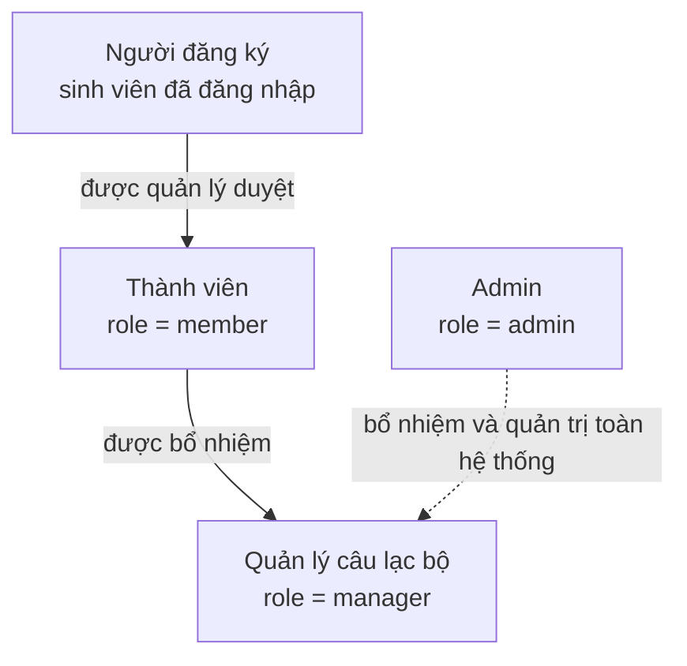
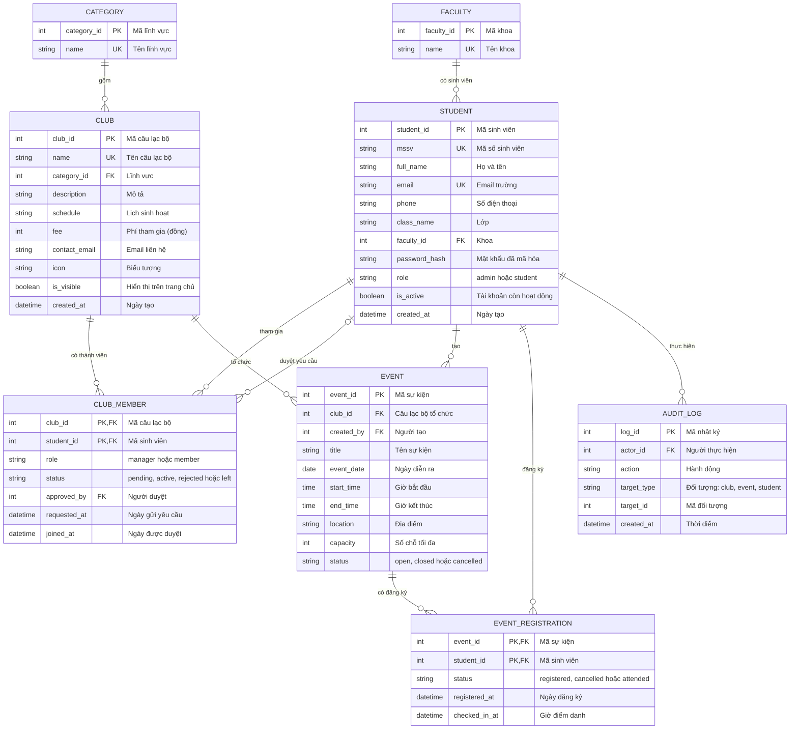

# Thiết kế cơ sở dữ liệu và phân quyền - Student Hub

Tài liệu mô tả cơ sở dữ liệu của hệ thống quản lý câu lạc bộ và sinh viên, có phân quyền theo 4 vai trò: Admin, Quản lý, Thành viên và Người đăng ký.
Tên bảng và tên cột giữ bằng tiếng Anh để dùng trực tiếp trong code và SQL, phần giải thích viết bằng tiếng Việt.

## 1. Bốn vai trò trong hệ thống

| Vai trò | Lưu ở đâu | Ý nghĩa |
|---|---|---|
| Admin | `STUDENT.role = 'admin'` | Quản trị toàn hệ thống. Vai trò này gắn với tài khoản, không phụ thuộc câu lạc bộ nào. |
| Quản lý | `CLUB_MEMBER.role = 'manager'` | Chủ nhiệm hoặc ban điều hành của một câu lạc bộ. Quyền chỉ có hiệu lực trong câu lạc bộ đó. |
| Thành viên | `CLUB_MEMBER.role = 'member'` và `status = 'active'` | Sinh viên đã được duyệt vào câu lạc bộ. |
| Người đăng ký | `CLUB_MEMBER.status = 'pending'` hoặc có dòng trong `EVENT_REGISTRATION` | Sinh viên đã đăng nhập, đang chờ duyệt vào câu lạc bộ hoặc đã đăng ký tham dự sự kiện. Không cần là thành viên. |

Vai trò của một sinh viên có thể khác nhau ở từng câu lạc bộ. Ví dụ một sinh viên là Quản lý của CLB Công nghệ IT, đồng thời là Thành viên của CLB Tiếng Anh và Người đăng ký của một sự kiện bóng đá.

## 2. Sơ đồ quan hệ thực thể (ERD)

Chú thích ký hiệu: `PK` là khóa chính, `FK` là khóa ngoại, `UK` là giá trị không được trùng.

## 3. Bảng phân quyền

Dấu "Có" nghĩa là được phép. Với Quản lý và Thành viên, quyền chỉ áp dụng trong câu lạc bộ của chính họ.

| Chức năng | Người đăng ký | Thành viên | Quản lý | Admin |
|---|---|---|---|---|
| Xem danh sách câu lạc bộ và sự kiện | Có | Có | Có | Có |
| Gửi yêu cầu tham gia câu lạc bộ | Có | Có | Có | Có |
| Đăng ký và hủy đăng ký sự kiện | Có | Có | Có | Có |
| Xem danh sách thành viên của câu lạc bộ | Không | Có | Có | Có |
| Duyệt hoặc từ chối yêu cầu tham gia | Không | Không | Có | Có |
| Sửa thông tin câu lạc bộ | Không | Không | Có | Có |
| Tạo, sửa, hủy sự kiện | Không | Không | Có | Có |
| Xem danh sách người đăng ký và điểm danh | Không | Không | Có | Có |
| Tạo hoặc xóa câu lạc bộ | Không | Không | Không | Có |
| Bổ nhiệm hoặc bãi nhiệm Quản lý | Không | Không | Không | Có |
| Quản lý tài khoản sinh viên, khoa, lĩnh vực | Không | Không | Không | Có |
| Xem nhật ký hệ thống | Không | Không | Không | Có |

## 4. Từ điển dữ liệu

### FACULTY - Khoa

| Cột | Kiểu | Ràng buộc | Mô tả |
|---|---|---|---|
| faculty_id | int | PK | Mã khoa |
| name | string | UK | Tên khoa |

### STUDENT - Sinh viên (tài khoản)

| Cột | Kiểu | Ràng buộc | Mô tả |
|---|---|---|---|
| student_id | int | PK | Mã sinh viên |
| mssv | string | UK | Mã số sinh viên (6-12 chữ số) |
| full_name | string | | Họ và tên |
| email | string | UK | Email trường |
| phone | string | | Số điện thoại |
| class_name | string | | Lớp |
| faculty_id | int | FK | Khoa của sinh viên |
| password_hash | string | | Mật khẩu đã mã hóa, không lưu mật khẩu thô |
| role | string | | `admin` hoặc `student` |
| is_active | boolean | | `false` khi tài khoản bị khóa |
| created_at | datetime | | Ngày tạo tài khoản |

### CATEGORY - Lĩnh vực câu lạc bộ

| Cột | Kiểu | Ràng buộc | Mô tả |
|---|---|---|---|
| category_id | int | PK | Mã lĩnh vực |
| name | string | UK | Học thuật, Thể thao, Nghệ thuật, Cộng đồng |

### CLUB - Câu lạc bộ

| Cột | Kiểu | Ràng buộc | Mô tả |
|---|---|---|---|
| club_id | int | PK | Mã câu lạc bộ |
| name | string | UK | Tên câu lạc bộ |
| category_id | int | FK | Lĩnh vực |
| description | string | | Mô tả ngắn |
| schedule | string | | Lịch sinh hoạt |
| fee | int | | Phí tham gia mỗi học kỳ (đồng), 0 là miễn phí |
| contact_email | string | | Email liên hệ |
| icon | string | | Biểu tượng hiển thị trên thẻ |
| is_visible | boolean | | Ẩn câu lạc bộ khỏi trang chủ mà không cần xóa |
| created_at | datetime | | Ngày tạo |

### CLUB_MEMBER - Thành viên câu lạc bộ

Bảng trung gian giữa sinh viên và câu lạc bộ (quan hệ nhiều-nhiều). Đây là nơi lưu vai trò Quản lý, Thành viên và trạng thái Người đăng ký chờ duyệt.
Khóa chính ghép `(club_id, student_id)` đảm bảo một sinh viên không có hai dòng trong cùng một câu lạc bộ.

| Cột | Kiểu | Ràng buộc | Mô tả |
|---|---|---|---|
| club_id | int | PK, FK | Mã câu lạc bộ |
| student_id | int | PK, FK | Mã sinh viên |
| role | string | | `manager` hoặc `member` |
| status | string | | `pending` (chờ duyệt), `active` (đang tham gia), `rejected` (bị từ chối), `left` (đã rời) |
| approved_by | int | FK, có thể trống | Quản lý hoặc Admin đã duyệt |
| requested_at | datetime | | Ngày gửi yêu cầu |
| joined_at | datetime | có thể trống | Ngày được duyệt |

### EVENT - Sự kiện

| Cột | Kiểu | Ràng buộc | Mô tả |
|---|---|---|---|
| event_id | int | PK | Mã sự kiện |
| club_id | int | FK | Câu lạc bộ tổ chức |
| created_by | int | FK | Người tạo sự kiện |
| title | string | | Tên sự kiện |
| event_date | date | | Ngày diễn ra |
| start_time | time | | Giờ bắt đầu |
| end_time | time | | Giờ kết thúc |
| location | string | | Địa điểm |
| capacity | int | | Số chỗ tối đa |
| status | string | | `open` (mở đăng ký), `closed` (đóng đăng ký), `cancelled` (đã hủy) |

### EVENT_REGISTRATION - Đăng ký sự kiện

Bảng trung gian giữa sinh viên và sự kiện (quan hệ nhiều-nhiều). Mỗi dòng là một Người đăng ký.
Khóa chính ghép `(event_id, student_id)` đảm bảo một sinh viên chỉ đăng ký một lần cho mỗi sự kiện.

| Cột | Kiểu | Ràng buộc | Mô tả |
|---|---|---|---|
| event_id | int | PK, FK | Mã sự kiện |
| student_id | int | PK, FK | Mã sinh viên |
| status | string | | `registered` (đã đăng ký), `cancelled` (đã hủy), `attended` (đã tham dự) |
| registered_at | datetime | | Ngày đăng ký |
| checked_in_at | datetime | có thể trống | Giờ điểm danh tại sự kiện |

### AUDIT_LOG - Nhật ký hệ thống

Ghi lại các thao tác quan trọng (bổ nhiệm Quản lý, xóa câu lạc bộ, khóa tài khoản...) để Admin kiểm tra khi cần.

| Cột | Kiểu | Ràng buộc | Mô tả |
|---|---|---|---|
| log_id | int | PK | Mã nhật ký |
| actor_id | int | FK | Người thực hiện |
| action | string | | Hành động, ví dụ `appoint_manager` |
| target_type | string | | Loại đối tượng: `club`, `event`, `student` |
| target_id | int | | Mã của đối tượng |
| created_at | datetime | | Thời điểm thực hiện |

## 5. Quy tắc nghiệp vụ

- Hủy đăng ký hoặc rời câu lạc bộ chỉ đổi cột `status`, không xóa dòng, để giữ lại lịch sử.
- Mỗi câu lạc bộ phải luôn có ít nhất một Quản lý (dòng `role = 'manager'` và `status = 'active'`). Không cho phép rời hoặc bãi nhiệm Quản lý cuối cùng.
- Chỉ dòng có `status = 'active'` mới được tính là Thành viên và mới được hưởng quyền của vai trò đó.
- Số thành viên của câu lạc bộ bằng số dòng `CLUB_MEMBER` có `status = 'active'`.
- Số chỗ còn lại của sự kiện bằng `capacity` trừ số dòng `EVENT_REGISTRATION` có `status = 'registered'`. Khi số này bằng 0 hoặc `EVENT.status` khác `open`, không cho đăng ký thêm.
- Quản lý chỉ được thao tác trên câu lạc bộ mà mình có dòng `manager` đang `active`. Phần kiểm tra này phải làm ở máy chủ, không chỉ ẩn nút trên giao diện.
- Mọi thao tác của Admin và Quản lý như duyệt thành viên, bổ nhiệm, hủy sự kiện đều ghi vào `AUDIT_LOG`.

## 6. Đối chiếu với mã nguồn hiện tại

Giao diện hiện tại chưa có phân quyền, mọi người dùng chỉ có vai trò Người đăng ký và dữ liệu lưu trong trình duyệt.

| Trong `script.js` | Bảng tương ứng |
|---|---|
| Mảng `CLUBS` và đối tượng `DETAILS` | `CLUB` và `CATEGORY` |
| Mảng `EVENTS` | `EVENT` |
| Khóa `sh_clubs` trong `localStorage` | `CLUB_MEMBER` |
| Khóa `sh_events` trong `localStorage` | `EVENT_REGISTRATION` |
| Khóa `sh_profile` và `sh_login` | `STUDENT` |
