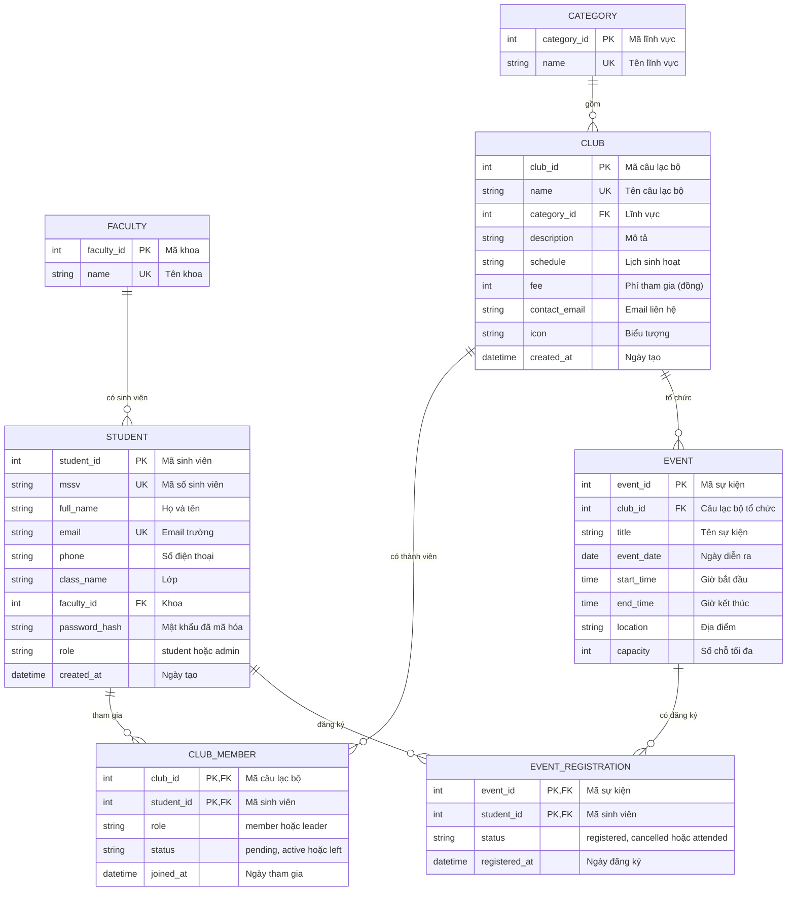

# Thiết kế cơ sở dữ liệu - Student Hub

Tài liệu mô tả cơ sở dữ liệu của hệ thống quản lý câu lạc bộ và sinh viên.
Tên bảng và tên cột giữ bằng tiếng Anh để dùng trực tiếp trong code và SQL, phần giải thích viết bằng tiếng Việt.

## Sơ đồ quan hệ thực thể (ERD)

Chú thích ký hiệu: `PK` là khóa chính, `FK` là khóa ngoại, `UK` là giá trị không được trùng.

## Từ điển dữ liệu

### FACULTY - Khoa

| Cột | Kiểu | Ràng buộc | Mô tả |
|---|---|---|---|
| faculty_id | int | PK | Mã khoa |
| name | string | UK | Tên khoa |

### STUDENT - Sinh viên

| Cột | Kiểu | Ràng buộc | Mô tả |
|---|---|---|---|
| student_id | int | PK | Mã sinh viên |
| mssv | string | UK | Mã số sinh viên (6-12 chữ số) |
| full_name | string | | Họ và tên |
| email | string | UK | Email trường |
| phone | string | | Số điện thoại |
| class_name | string | | Lớp |
| faculty_id | int | FK | Khoa của sinh viên |
| password_hash | string | | Mật khẩu đã mã hóa, không lưu mật khẩu thô |
| role | string | | `student` hoặc `admin` |
| created_at | datetime | | Ngày tạo tài khoản |

### CATEGORY - Lĩnh vực câu lạc bộ

| Cột | Kiểu | Ràng buộc | Mô tả |
|---|---|---|---|
| category_id | int | PK | Mã lĩnh vực |
| name | string | UK | Học thuật, Thể thao, Nghệ thuật, Cộng đồng |

### CLUB - Câu lạc bộ

| Cột | Kiểu | Ràng buộc | Mô tả |
|---|---|---|---|
| club_id | int | PK | Mã câu lạc bộ |
| name | string | UK | Tên câu lạc bộ |
| category_id | int | FK | Lĩnh vực |
| description | string | | Mô tả ngắn |
| schedule | string | | Lịch sinh hoạt |
| fee | int | | Phí tham gia mỗi học kỳ (đồng), 0 là miễn phí |
| contact_email | string | | Email liên hệ |
| icon | string | | Biểu tượng hiển thị trên thẻ |
| created_at | datetime | | Ngày tạo |

### CLUB_MEMBER - Thành viên câu lạc bộ

Bảng trung gian giữa sinh viên và câu lạc bộ (quan hệ nhiều-nhiều).
Khóa chính ghép `(club_id, student_id)` đảm bảo một sinh viên không tham gia cùng một câu lạc bộ hai lần.

| Cột | Kiểu | Ràng buộc | Mô tả |
|---|---|---|---|
| club_id | int | PK, FK | Mã câu lạc bộ |
| student_id | int | PK, FK | Mã sinh viên |
| role | string | | `member` (thành viên) hoặc `leader` (chủ nhiệm) |
| status | string | | `pending` (chờ duyệt), `active` (đang tham gia), `left` (đã rời) |
| joined_at | datetime | | Ngày tham gia |

### EVENT - Sự kiện

| Cột | Kiểu | Ràng buộc | Mô tả |
|---|---|---|---|
| event_id | int | PK | Mã sự kiện |
| club_id | int | FK | Câu lạc bộ tổ chức |
| title | string | | Tên sự kiện |
| event_date | date | | Ngày diễn ra |
| start_time | time | | Giờ bắt đầu |
| end_time | time | | Giờ kết thúc |
| location | string | | Địa điểm |
| capacity | int | | Số chỗ tối đa |

### EVENT_REGISTRATION - Đăng ký sự kiện

Bảng trung gian giữa sinh viên và sự kiện (quan hệ nhiều-nhiều).
Khóa chính ghép `(event_id, student_id)` đảm bảo một sinh viên chỉ đăng ký một lần cho mỗi sự kiện.

| Cột | Kiểu | Ràng buộc | Mô tả |
|---|---|---|---|
| event_id | int | PK, FK | Mã sự kiện |
| student_id | int | PK, FK | Mã sinh viên |
| status | string | | `registered` (đã đăng ký), `cancelled` (đã hủy), `attended` (đã tham dự) |
| registered_at | datetime | | Ngày đăng ký |

## Quy tắc nghiệp vụ

- Hủy đăng ký hoặc rời câu lạc bộ chỉ đổi cột `status`, không xóa dòng, để giữ lại lịch sử.
- Số thành viên của một câu lạc bộ bằng số dòng `CLUB_MEMBER` có `status = 'active'`.
- Số chỗ còn lại của sự kiện bằng `capacity` trừ số dòng `EVENT_REGISTRATION` có `status = 'registered'`. Khi số này bằng 0, không cho đăng ký thêm.
- Chỉ tài khoản có `role = 'admin'` được thêm, sửa, xóa câu lạc bộ và sự kiện.

## Đối chiếu với mã nguồn hiện tại

| Trong `script.js` | Bảng tương ứng |
|---|---|
| Mảng `CLUBS` và đối tượng `DETAILS` | `CLUB` và `CATEGORY` |
| Mảng `EVENTS` | `EVENT` |
| Khóa `sh_clubs` trong `localStorage` | `CLUB_MEMBER` |
| Khóa `sh_events` trong `localStorage` | `EVENT_REGISTRATION` |
| Khóa `sh_profile` trong `localStorage` | `STUDENT` |
